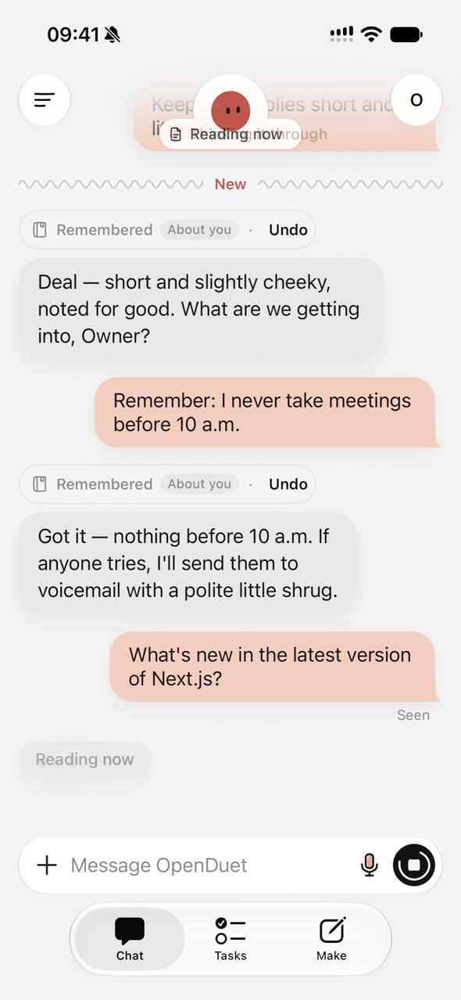
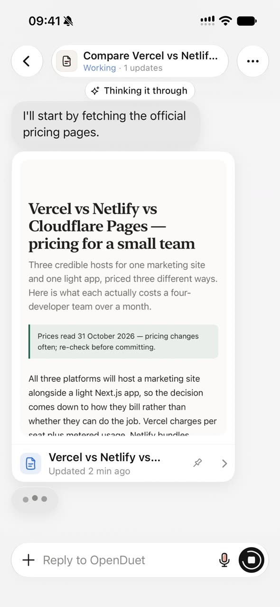
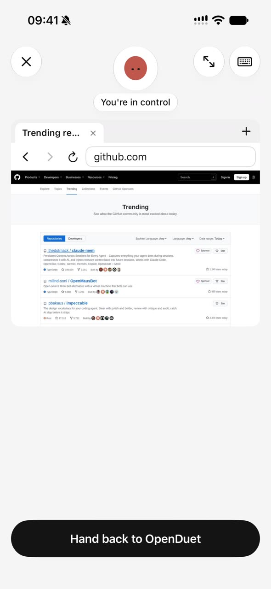
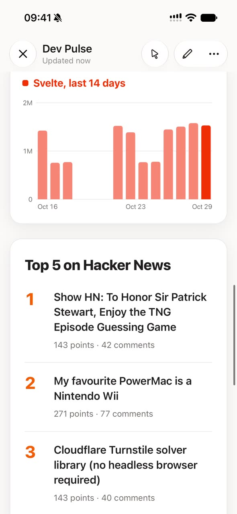

<p align="center">
  
</p>

<h1 align="center">OpenDuet</h1>

<p align="center">
  <b>The open-source Claude Duet.</b><br>
  A proactive AI assistant on your own server: it notices what needs doing, does it in the background, and reaches out when it needs you.
</p>

<p align="center">
  <a href="#what-it-is">What it is</a> ·
  <a href="#features">Features</a> ·
  <a href="#deploy">Deploy</a> ·
  <a href="docs/DEPLOY.md">Deployment guide</a> ·
  <a href="README.zh-CN.md">中文</a>
</p>

<p align="center">
  
  
  
  
  
  <a href="LICENSE"></a>
</p>

<p align="center"><sub>OpenDuet is an independent project, not affiliated with Anthropic.</sub></p>

https://github.com/user-attachments/assets/152ac85d-f14f-4991-a39b-05f97abeb0b4

## What it is

The backend and OpenDuet's own computer run on your server, and the iPhone app is the remote control. Work keeps running on the server while your phone is away. Unlike the original, it works with any model, and you can watch it use its browser and take over at any time.

<p align="center">
  
  
  
  
</p>
<p align="center"><sub>Chat and memory · A task at work · Taking over its browser · A dashboard made with Make</sub></p>

- **It comes to you**: a morning brief, a few check-ins through the day, suggestions when it spots something it can take off your plate, and news about the things you follow.
- **It works in the background**: what you hand it becomes a task that runs on the server. You get a notification when the task is done or needs you.
- **It asks before it acts**: sending an email, signing or deleting shows you an approval card first, and nothing happens until you tap it.
- **It has its own computer**: a browser and a shell on your server, for getting things done on the web and working with Office files. Watch it live and take over any time.
- **Realtime voice calls**: talk to it like a phone call. It works while you talk, reads progress and results back to you, and the call stays up when you lock the phone.
- **It remembers you**: it notes things about you on its own and tidies its memory while idle. Every note can be undone or edited, and it never stores passwords or card numbers.
- **Your data stays with you**: chats, memory, files and the sites OpenDuet is signed in to live only on your server. Keys you enter in the app are stored encrypted, and the model never sees them. Accounts are created on the server; there is no public sign-up.
- **Any model**: it speaks the Anthropic and OpenAI APIs, so the official APIs and gateways such as OpenRouter, DeepSeek, Zhipu GLM, Qwen or a local Ollama all work. No model is hard-coded.

## Features

### Chat and channels

- One main thread, plus channels for topics. Each channel has its own purpose and can use its own model; Everything gathers them all.
- Set its name, what it calls you and its tone right in the chat.
- Replies can carry task cards, suggestion cards, quick replies, images and files, and you can send it photos and files.

### Memory

- "About you" is shared by every channel; each channel also keeps a memory of its own that other channels can't see.
- When it notes something new, the chat shows "Remembered · Undo". You can view and edit all of its memory in the app.
- While idle it tidies its memory in the background, dropping duplicates and anything you asked it to forget. It never stores passwords, API keys, card numbers or ID numbers.
- Past chats are searchable, Chinese included.

### Proactive help

- On day one it looks through your email, calendar and recent files, then tells you how it plans to help. If something's off, say so and it learns.
- Briefs and check-ins run on weekdays until you say yes to weekends.
- When it finds something it can do for you, it posts a suggestion card. Swipe right to start it.

### Tasks

- What you hand it runs in the background. The Tasks tab groups tasks by status: Ready for review, Needs input, Working, Scheduled and Resolved.
- Each task shows the step it is on, the decisions it made and the resources it used.
- Scheduled tasks repeat at the times you set.

### It asks first

- Writes go through approval: read the full email, ask for changes in chat, then tap Send. Signatures and deletes work the same way.
- Set tool permissions per connected app. Reads default to Always, writes to Ask.

### Connect your apps

- Connect Gmail, Google Calendar, Google Drive, Slack, Notion and more through Composio, signing in on each app's own page. This needs a Composio key on the server.
- Add remote MCP servers in one tap from a curated list or the official MCP Registry, with OAuth sign-in, or paste a Claude, Cursor, VS Code or Zed config.
- Add your own connectors too: an MCP server address, or an API key bound to one domain. That key is only ever sent to its domain, and the model never sees it.
- Skills, connectors and apps work in every channel by default, or only in the channels you pick.
- Built-in web search, weather, exchange rates and feed reading need no keys. Weather uses Open-Meteo's free API, which is for non-commercial use only; commercial deployments, see [docs/DEPLOY.md](docs/DEPLOY.md#built-in-tools-no-keys).

### OpenDuet's computer (optional)

- An isolated Chromium browser on your server. OpenDuet uses it to open sites, look things up and fill in forms, getting things done on the web for you.
- Watch it live from your phone, take over any time, and hand it back.
- When a site needs your password, it posts a sign-in card. The password goes straight into the browser, never to the model. At a human check it stops and asks you.
- It also has a shell with git, python3 and OfficeCLI, so it can read and write Word, Excel and PowerPoint files.
- The computer sits on an internal network with no route out. All its traffic goes through a proxy, so it can't reach your LAN, and it never gets the model or other service keys. Without it, chat, tasks, search and connected apps still work.

### Make

- Describe it in a sentence and get a web page, doc, slide deck, dashboard, design or design system, built from real data in your connected apps.
- Dashboards can refresh on a schedule. Every change is a version you can undo.
- Pin the ones you use to the tab bar. Make needs OpenDuet's computer.

### Realtime voice

- Start a voice call from a channel, on a Google Gemini or StepFun realtime model with your own key.
- The voice model only listens and speaks; OpenDuet does the work. It reads progress and results back to you.
- Live captions run during the call. After you hang up, the chat keeps a call line that opens the full transcript.
- On a call it never approves anything for you; when an approval card comes up, it reminds you to tap it. Locking the phone or switching apps doesn't end the call.
- Dictation works while typing too: the phone's own recognition by default, or cloud recognition, which keeps neither the audio nor the text.

### Skills and models

- **Skills**: ask it in chat to save a way of working as a skill, upload a skill file or import one from GitHub, and call it with `/`. Built-in helpers cover Office and PDF documents, data exploration, meeting minutes and more.
- **Models and usage**: add model providers in the app and pick a model and thinking level per channel. The Usage page breaks token use down by model and by kind, and the server can set limits.

## Deploy

### What you need

- **Hardware**: at least 2 vCPU, 4 GB of RAM and 40 GB of disk. The browser that OpenDuet's computer runs takes the most.
- **Software**: Docker with the compose plugin (v2.20+), git and openssl.
- **A model**: a model gateway's base URL, API key and model id, Anthropic protocol or OpenAI-compatible.
- **The app**: an iPhone on iOS 18 or later; Xcode 26 or later, and Homebrew to install XcodeGen.

### 1. Run setup.sh

```sh
git clone https://github.com/Ddd0213/openduet.git && cd openduet
./scripts/setup.sh
```

setup.sh first checks Docker and openssl and tells you how to install whatever is missing. Then it asks, in this order:

1. **How the phone connects**: pick one of four modes (see the table in the next step), then the address the app will use. LAN only fills in your LAN IP, so just press Enter; Tailscale reads the address from Tailscale on this machine and asks only if it can't; Domain + Caddy and Cloudflare Tunnel take your `https://` domain, and Tunnel also asks for its token.
2. **The model gateway**: protocol (`anthropic` or `openai`), base URL, API key and model id. The model id must match the gateway's spelling exactly.
3. **Optional services**: a Composio key (needed to connect apps such as Gmail and Calendar), a web search provider, and push. Press Enter to skip any of them; for web search, Enter uses the key-less default. You can add them later.
4. **Whether to deploy OpenDuet's computer**: yes by default. Skipping it saves about 2.4 GB of disk and up to 2 GB of memory, but then OpenDuet can't use a browser for you or build Make pages.

It then builds the images, starts every service, and checks the model once they are all healthy. The first build downloads Chromium, so it takes a while.

5. **Your account**: a username, your full name and a password (hidden as you type). The password needs at least 12 characters, and common passwords are refused. On a machine with a public IP, or with Domain + Caddy or Cloudflare Tunnel, it suggests generating one; a generated password is shown only once, so save it right away.

Last, it prints the address for the app and what to do next. If the model check fails, fix the model settings in `backend/.env` as it says, then run `docker compose up -d && docker compose exec backend bun run models:check`. Re-running setup.sh is safe: existing settings and data are kept.

### 2. Connect your phone

For the mode you picked in step 1, do what the last column says. setup.sh prints this at the end too:

| Mode | When to use it | What else to do |
|---|---|---|
| LAN only | The phone and this machine share a Wi-Fi network | Open port 3000 in the firewall, for the LAN only |
| Tailscale | You'd rather not open ports to the internet | Run `tailscale serve --bg 3000` once on this machine, and install Tailscale on the phone |
| Domain + Caddy | You have a public IP and a domain | Point the domain at this machine and open ports 80 and 443 |
| Cloudflare Tunnel | No public IP; your domain is on Cloudflare | Create a tunnel in the Cloudflare dashboard, give its token to setup.sh, and route the public hostname to `http://backend:3000` |

Don't use LAN only on a machine with a public IP: it serves plain HTTP.

Then open `<address>/api/server-info` in Safari on the phone. A short JSON reply with `name` and `version` means the phone can reach the server. If it doesn't load, see [Troubleshooting](docs/DEPLOY.md#troubleshooting) in the deployment guide.

### 3. Install the app

```sh
brew install xcodegen
cd ios && xcodegen generate && open OpenDuet.xcodeproj
```

Then in Xcode:

1. Select the OpenDuet project on the left, then the OpenDuet target, and open Signing & Capabilities. Pick your account as the Team; if you haven't signed in yet, choose Add an Account… in that menu and sign in with your Apple ID. Change the Bundle Identifier from `dev.openduet.OpenDuet` to one of your own, such as `com.<yourname>.OpenDuet`.
2. Connect your iPhone with a cable, select it at the top of the window and click Run (▶).
3. The first time you install on this phone, turn on Developer Mode in Settings › Privacy & Security › Developer Mode; the phone restarts. If the app says "Untrusted Developer" when you open it, trust your developer certificate in Settings › General › VPN & Device Management.

`xcodegen generate` recreates the project, so set the Team and Bundle Identifier again whenever you run it.

### 4. Sign in

Open the app and enter the server address (the one setup.sh printed), your username and your password. With LAN only, iOS asks whether the app may find devices on your local network; choose Allow. After you sign in, follow the onboarding and you're ready to go.

### More deployment docs

Every setup.sh option, each connection mode in detail, hardening a public deployment, push, updates, backups, network issues and troubleshooting are in [docs/DEPLOY.md](docs/DEPLOY.md).

OpenDuet is released under the [MIT License](LICENSE). Third-party components and their licenses: [THIRD_PARTY_NOTICES.md](THIRD_PARTY_NOTICES.md).
