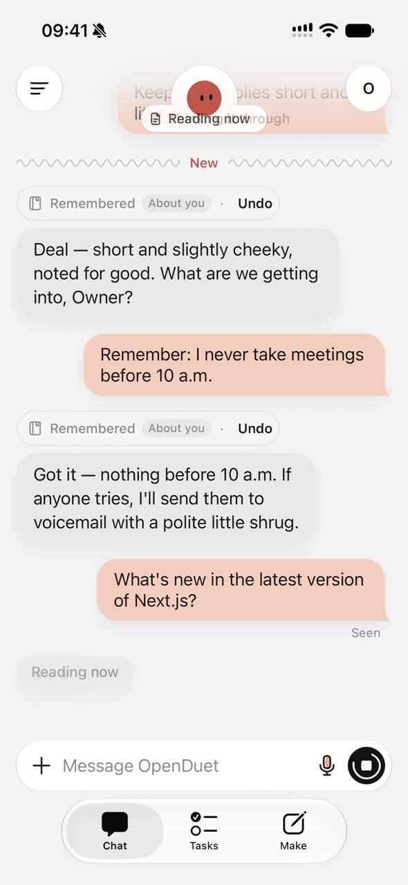
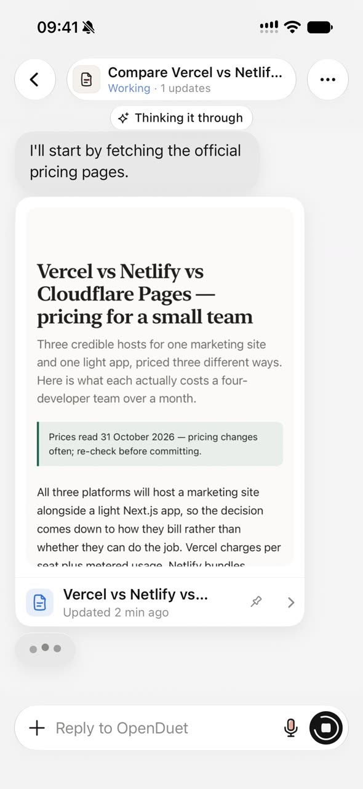
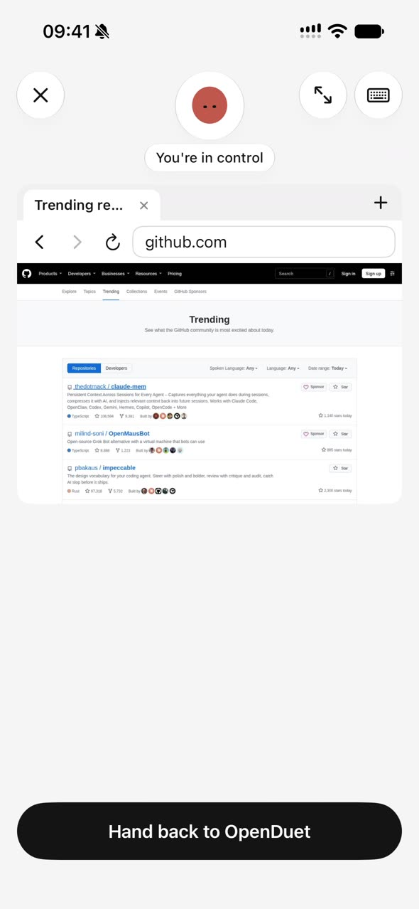
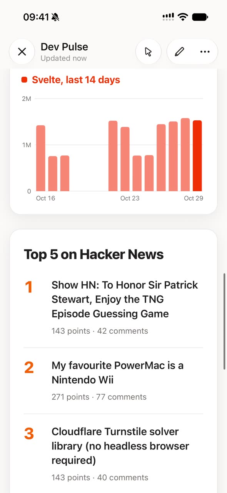

<p align="center">
  
</p>

<h1 align="center">OpenDuet</h1>

<p align="center">
  <b>开源的 Claude Duet。</b><br>
  一个跑在你自己服务器上的主动式 AI 助手：它会留意需要做的事，在后台完成，需要你时再来找你。
</p>

<p align="center">
  <a href="#它是什么">它是什么</a> ·
  <a href="#主要功能">主要功能</a> ·
  <a href="#部署">部署</a> ·
  <a href="docs/DEPLOY.zh-CN.md">部署文档</a> ·
  <a href="README.md">English</a>
</p>

<p align="center">
  
  
  
  
  
  <a href="LICENSE"></a>
</p>

<p align="center"><sub>OpenDuet 是独立项目，和 Anthropic 没有关系。</sub></p>

https://github.com/user-attachments/assets/152ac85d-f14f-4991-a39b-05f97abeb0b4

## 它是什么

后端和 OpenDuet 自己的电脑跑在你的服务器上，iPhone App 是遥控器。手机不在线时，任务照常在服务器上进行。和原版不同，它能接任何模型，你也能看着它操作浏览器、随时接管。

<p align="center">
  
  
  
  
</p>
<p align="center"><sub>聊天和记忆 · 进行中的任务 · 接管它的浏览器 · 用创作做的仪表盘</sub></p>

- **主动来找你**：每天早上发一份简报，白天做几次例行检查，看到它能帮上忙的事就提出来。你关注的事有了新消息，它也会告诉你。
- **在后台把事做完**：交给它的事变成任务，在服务器上跑。做完或者需要你时，它会发通知。
- **先问再动手**：发邮件、签名、删除这类操作，它都先给你看一张审批卡片，你点了才执行。
- **有自己的电脑**：服务器上有它自己的浏览器和 shell，能上网办事、处理 Office 文件。你可以看实时画面，随时接管。
- **实时语音通话**：像打电话一样跟它说话，它边听边做事，把进度和结果念给你听，锁屏也不挂断。
- **记得你**：它会自己记下关于你的事，空闲时整理记忆。每条都能撤销或修改，密码和卡号这类信息不会记。
- **数据在你自己手里**：聊天、记忆、文件，以及 OpenDuet 登录过的网站，都只存在你的服务器上。你在 App 里填的 key 加密保存，模型看不到。账号在服务器上创建，没有公开注册。
- **模型随你选**：兼容 Anthropic 和 OpenAI 两种接口，官方 API、OpenRouter、DeepSeek、智谱 GLM、通义千问、本地 Ollama 这类网关都能接。代码里不写死任何模型。

## 主要功能

### 聊天和频道

- 一个主对话，另外可以按主题建频道，每个频道有自己的用途，也可以选自己的模型。「全部」汇总所有频道。
- 它的名字、怎么称呼你、语气，都可以在聊天里设定。
- 回复里可以有任务卡片、建议卡片、快捷回复、图片和文件。你也可以发照片和文件给它。

### 记忆

- 「关于你」的记忆所有频道共用；每个频道另有一份自己的记忆，频道之间互相看不到。
- 它记下新东西时，聊天里会出现「已记住 · 撤销」。所有记忆都能在 App 里查看和修改。
- 空闲时它会在后台整理记忆，去掉重复的内容和你让它忘掉的事。密码、API key、银行卡号、身份证号不会记。
- 过去的聊天都能搜索，中文同样能搜。

### 主动帮忙

- 刚用的时候，它会先看一遍你的邮件、日历和最近的文件，然后说说打算怎么帮你。说得不对，告诉它就行，它会记住。
- 晨间简报和例行检查默认只在工作日进行，你同意后周末也会有。
- 它发现能帮你做的事，会发一张建议卡片，往右滑就开始做。

### 任务

- 交给它的事在后台运行。任务页按状态分组：待审阅、等你处理、进行中、定时、已完成。
- 每个任务都能看到它在做哪一步、做了什么决定、用了哪些资料。
- 可以设定时任务，按你定的时间重复执行。

### 先问再动手

- 写类操作都要经过审批：邮件可以先看全文，也可以在聊天里让它改，再点发送；签名、删除也一样。
- 每个连接的 App 可以逐个设置工具权限，读默认「始终允许」，写默认「先问我」。

### 连接你的 App

- 通过 Composio 连接 Gmail、Google 日历、Google Drive、Slack、Notion 等 App，登录走官方授权页面。这需要在服务器上配置 Composio 的 key。
- 可以添加远程 MCP 服务器：从精选列表或官方 MCP Registry 一键添加，支持 OAuth 登录；也能直接粘贴 Claude、Cursor、VS Code、Zed 的配置。
- 也可以自己加连接器：填一个 MCP 服务器地址，或者绑定到某个域名的 API key。这个 key 只会发给那个域名，模型看不到。
- 技能、连接器和 App 默认所有频道都能用，也可以只开给指定的频道。
- 网页搜索、天气、汇率、读订阅源这几个内置工具不用任何 key。天气用的是 Open-Meteo 的免费接口，只限非商业使用，商业部署见[部署文档](docs/DEPLOY.zh-CN.md#内置工具不用-key)。

### OpenDuet 的电脑（可选）

- 服务器上一个隔离的 Chromium 浏览器。OpenDuet 用它打开网站、查资料、填表，帮你在网上办事。
- 你可以在手机上看实时画面，随时接管，用完交还给它。
- 网站要密码时，它会发一张登录卡片。密码直接填进浏览器，不经过模型。遇到人机验证，它会停下来叫你。
- 它还有一个 shell，带 git、python3 和 OfficeCLI，能读写 Word、Excel、PPT 文件。
- 这台电脑跑在没有出口路由的内网里，所有流量都经过代理，碰不到你的局域网，也拿不到模型等服务的 key。不部署它，聊天、任务、搜索和连接的 App 照样能用。

### 创作

- 一句话做出网页、文档、幻灯片、仪表盘、设计稿和设计系统，内容用的是你已连接的 App 里的真实数据。
- 仪表盘可以按计划自动刷新数据。每次修改都有版本记录，可以撤销。
- 常用的作品可以固定到底栏，随时打开。创作需要 OpenDuet 的电脑。

### 实时语音

- 在频道里发起语音通话，用 Google Gemini 或阶跃星辰的实时模型，需要你自己的 key。
- 语音模型只负责听和说，事情交给 OpenDuet 去做。它会把进度和结果念给你听。
- 通话时有实时字幕。挂断后聊天里留一行通话记录，点开能看完整转写。
- 通话里它不会替你批准任何操作，有审批卡片时会提醒你去点。锁屏或切到后台都不挂断。
- 打字时也能用语音听写：默认用手机自带的识别，也可以改用云端识别，云端识别的录音和文字都不保存。

### 技能和模型

- **技能**：在聊天里让它把一种做法存成技能，也可以上传技能文件或从 GitHub 导入，输入 `/` 调用。另外内置了处理 Office 和 PDF 文档、数据探索、会议纪要等场景的助手。
- **模型和用量**：可以在 App 里添加模型服务商，每个频道选不同的模型和思考强度。用量页按模型和类型统计 token 消耗，服务器上可以设置上限。

## 部署

### 你需要准备

- **配置**：至少 2 vCPU、4 GB 内存、40 GB 磁盘。最占资源的是 OpenDuet 的电脑用的浏览器。
- **要装的软件**：Docker 和 compose 插件（v2.20 及以上）、git、openssl。
- **模型**：一个模型网关的 base URL、API key 和模型 id，Anthropic 协议或 OpenAI 兼容协议都行。
- **App**：一台 iOS 18 以上的 iPhone；Xcode 26 或更新版本，以及用来装 XcodeGen 的 Homebrew。

### 1. 运行 setup.sh

```sh
git clone https://github.com/Ddd0213/openduet.git && cd openduet
./scripts/setup.sh
```

setup.sh 先检查 Docker 和 openssl，缺什么会告诉你怎么装。然后按顺序问你：

1. **手机怎么连过来**：四种方式选一种（见下一步的表），再填 App 要用的地址。仅局域网会自动填好局域网 IP，回车即可；Tailscale 能从这台机器上的 Tailscale 读出地址，读不到再手动填；域名 + Caddy 和 Cloudflare Tunnel 填你的 `https://` 域名，Tunnel 还要填 token。
2. **模型网关**：协议（`anthropic` 或 `openai`）、base URL、API key、模型 id。模型 id 要和网关里的写法完全一致。
3. **可选服务**：Composio 的 key（连接 Gmail、日历等 App 要用）、网页搜索服务商、推送。直接回车就跳过；网页搜索回车会用免 key 的默认搜索。以后都能再加。
4. **要不要部署 OpenDuet 的电脑**：默认部署。不部署能省下约 2.4 GB 磁盘和最多 2 GB 内存，但它就不能用浏览器帮你办事，也不能做创作。

接着它构建镜像、启动所有服务，等全部就绪后检查模型能不能用。第一次构建要下载 Chromium，会花一些时间。

5. **创建账号**：用户名、姓名和密码（输入时不会显示）。密码至少 12 位，常见密码会被拒。机器有公网 IP，或者用域名 + Caddy、Cloudflare Tunnel 时，它会建议自动生成密码；生成的密码只显示一次，记得马上存好。

最后它打印 App 要填的地址和下一步要做的事。模型检查没通过时，按提示改 `backend/.env` 里的模型设置，再运行 `docker compose up -d && docker compose exec backend bun run models:check`。重复运行 setup.sh 是安全的，已有的配置和数据都会保留。

#### 主动消息（默认开启）

新部署默认开启自动晨报和定时主动检查。开关是 `backend/.env` 中的 `PROACTIVE_BUILTINS`：

| 值 | 效果 |
|---|---|
| `1`（默认） | 开启自动晨报和定时主动检查。 |
| `0` | 关闭这两类自动任务。 |

主动检查没事时保持安静，不会每次都发消息。用户设置的主动程度和每日触达上限仍然生效，主动检查还受勿扰时间限制。这个开关**不会关闭**你创建的提醒、定时任务、一次性的初次引导扫描，以及任务完成或审批通知。

已有部署会保留原设置：更新代码或重新运行 setup.sh 不会把已有的 `0` 自动改成 `1`。要修改，编辑 `backend/.env` 中的 `PROACTIVE_BUILTINS`，然后在仓库目录运行以下命令，只重新创建后端容器并加载新值：

```sh
docker compose up -d --no-deps --force-recreate backend
```

只运行 `docker compose restart` 不会重新读取环境文件。

### 2. 让手机连上

按你在第 1 步选的方式，做下表最后一列的事。setup.sh 结尾也会提示：

| 方式 | 什么时候用 | 还要做什么 |
|---|---|---|
| 仅局域网 | 手机和这台机器在同一个 Wi-Fi | 防火墙只对局域网放行 3000 端口 |
| Tailscale | 不想对公网开端口 | 在这台机器上运行一次 `tailscale serve --bg 3000`，手机装 Tailscale |
| 域名 + Caddy | 有公网 IP 和域名 | 域名解析到这台机器，放行 80 和 443 端口 |
| Cloudflare Tunnel | 没有公网 IP，域名托管在 Cloudflare | 在 Cloudflare 控制台建隧道，把 token 填给 setup.sh，公网主机名指向 `http://backend:3000` |

有公网 IP 的机器不要用「仅局域网」，那是明文 HTTP。

做完后在手机的 Safari 里打开 `<地址>/api/server-info`。看到一段带 `name` 和 `version` 的 JSON，就说明手机能连上服务器了。打不开的话，见部署文档的[排错](docs/DEPLOY.zh-CN.md#排错)。

### 3. 安装 App

```sh
brew install xcodegen
cd ios && xcodegen generate && open OpenDuet.xcodeproj
```

然后在 Xcode 里：

1. 左边选中 OpenDuet 项目，再选 OpenDuet target，打开 Signing & Capabilities。Team 选你的账号；还没登录过的话，在下拉框里选 Add an Account… 登录 Apple ID。Bundle Identifier 从 `dev.openduet.OpenDuet` 改成你自己的，比如 `com.<你的名字>.OpenDuet`。
2. 用数据线连上 iPhone，在窗口顶部选中它，点 Run（▶）。
3. 第一次装到这台手机时，在「设置 › 隐私与安全性 › 开发者模式」里打开开发者模式，手机会重启。打开 App 时如果提示「未受信任的开发者」，到「设置 › 通用 › VPN与设备管理」里信任你的开发者证书。

`xcodegen generate` 每次都会重新生成工程，之后再运行它，要重新设置 Team 和 Bundle Identifier。

### 4. 登录

打开 App，填服务器地址（setup.sh 打印的那个）、用户名和密码。用「仅局域网」时，iOS 会问 App 能不能查找本地网络上的设备，选允许。登录后跟着引导走完，就能开始用了。

### 更多部署说明

setup.sh 的全部选项、每种连接方式的详细配置、公网部署的加固、推送、更新、备份、网络问题和排错，见 [docs/DEPLOY.zh-CN.md](docs/DEPLOY.zh-CN.md)。

OpenDuet 以 [MIT 许可证](LICENSE)发布。第三方组件和它们的许可证见 [THIRD_PARTY_NOTICES.md](THIRD_PARTY_NOTICES.md)。
